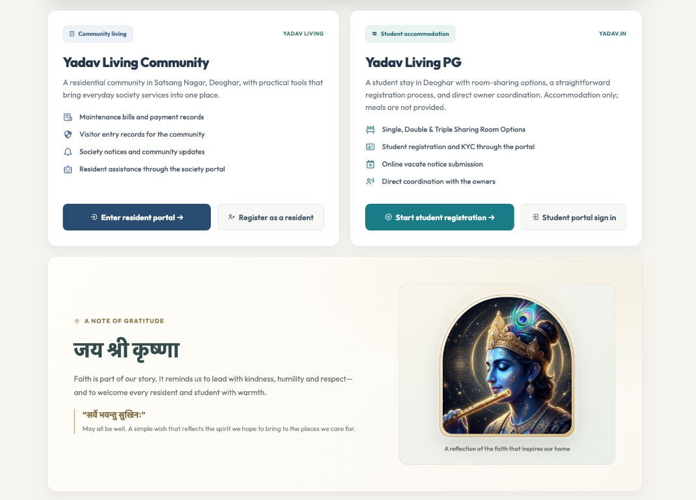
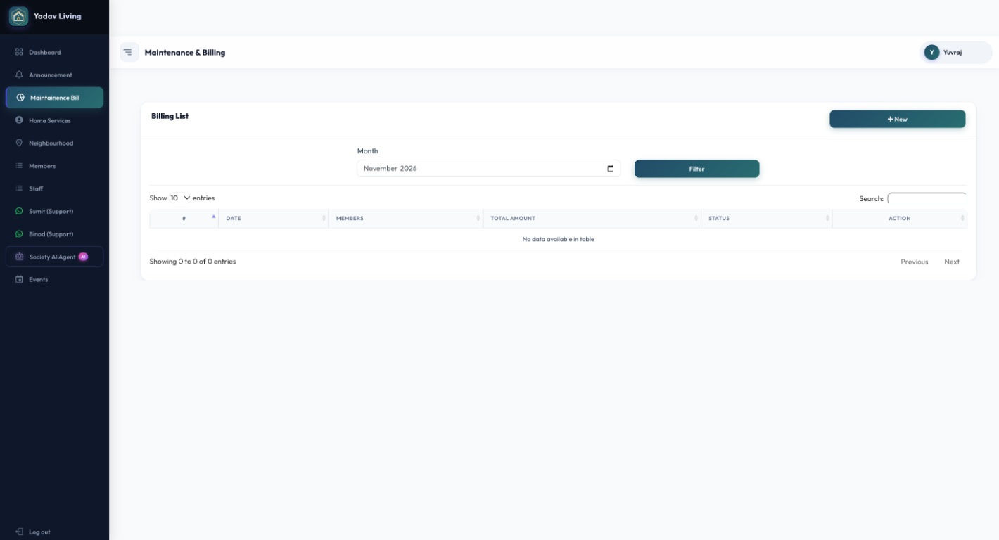
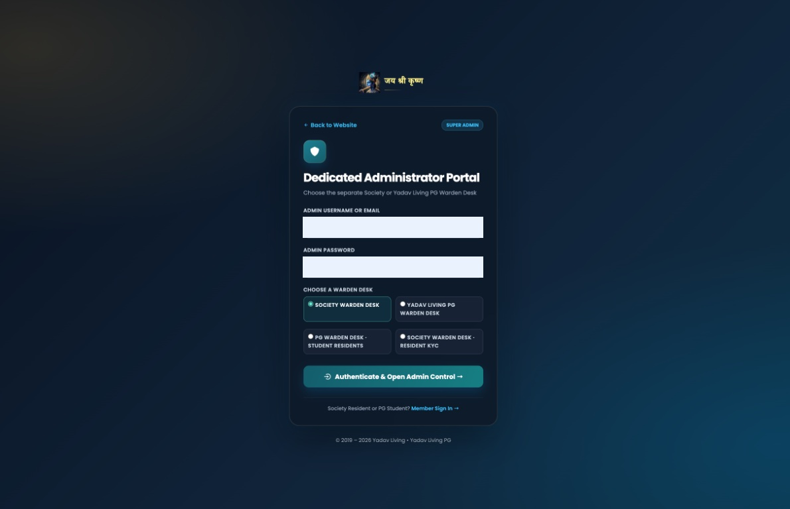
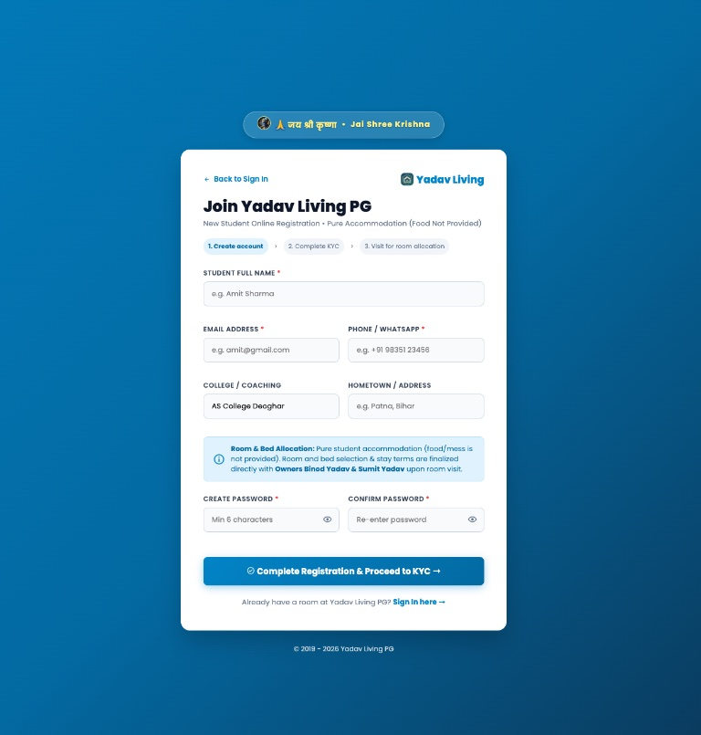
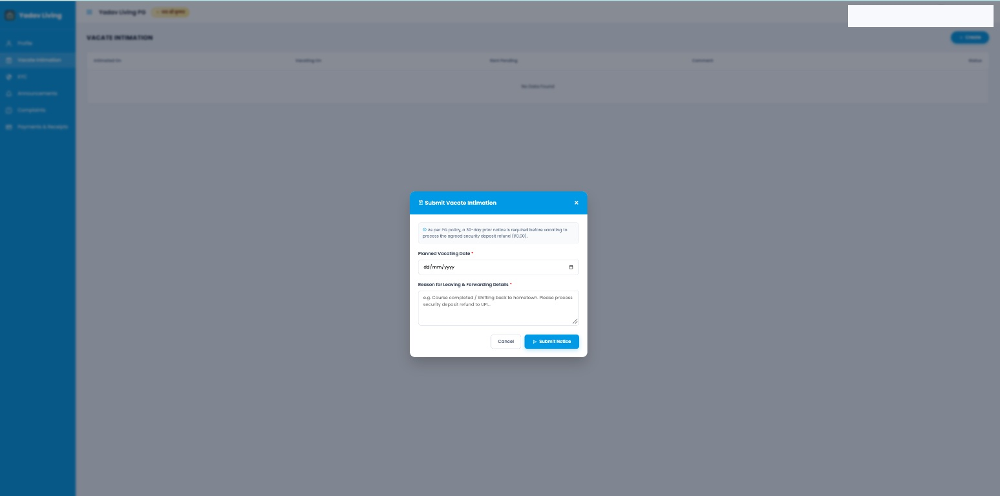
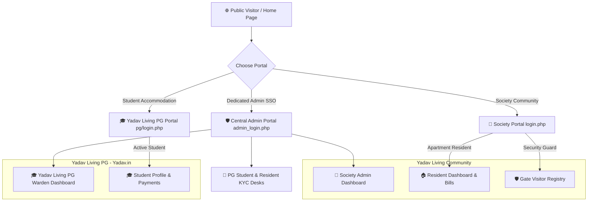
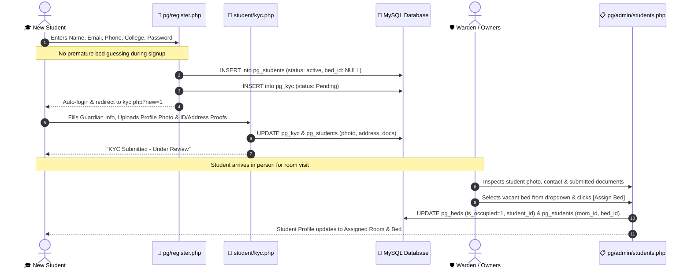

# Yadav Living

**Yadav Living** is the community living brand, with **Yadav Living PG** providing student accommodation. Residents, students, staff, and administrators use a consistent Yadav Living experience.

> **Project type:** Freelance client project
>
> **Role:** Full-stack developer and platform architect

[](https://www.php.net/)
[](https://fastapi.tiangolo.com/)
[](https://www.mysql.com/)
[](https://www.docker.com/)
[](https://threejs.org/)
[](LICENSE)

> **🙏 जय श्री कृष्णा &bull; सर्वे भवन्तु सुखिनः सर्वे सन्तु निरामयाः &bull; Jai Shree Krishna 🙏**  
> *"Dedicated to harmonious, virtuous, and technologically advanced living under divine grace."*

> **Team reminder:** You're writing this for your team, not just for yourself. Keep setup steps, security notes, and operational instructions accurate and usable by the next person.

> **Deployment status (November 2026):** The Docker image builds locally, but the application has not been deployed or certified for production. A production database, persistent private KYC file storage, deployment secrets, and additional security validation are still required. Do not use real resident or student data until the production checklist below is complete.

---

## 📌 Executive Summary (For You & Your Team)

**Yadav Living** is a dual-property residential management and student accommodation application built with PHP, MySQL, Python/FastAPI, and Three.js WebGL. The Docker image currently uses PHP 8.2 with Apache; local development has also been checked with PHP 8.4.

The platform seamlessly bridges two property models within a unified operational architecture:

1. **🏢 Yadav Living Society**: A residential management portal with maintenance billing, a gate visitor registry, resident KYC workflows, a retrieval-grounded AI assistant, and an interactive 3D campus visualizer.
2. **🎓 Yadav Living PG**: A student accommodation portal with registration, KYC workflows, configurable room and bed assignments, and a warden operations desk.

### Property locations

- **Yadav Living Society:** AS College Road, Satsang Nagar Near Atal Smriti Park Deoghar, Jharkhand 814112
- **Yadav Living PG:** Hirna Near Tv relay Center Near AS College Road Dewan baba Deoghar, Jharkhand 814112

The public property page and the Society and PG location views provide Google Maps search links for these addresses.

## 🖼️ Application screenshots

The following gallery shows the public property page and selected Society and PG portal screens.

<table>
  <tr>
    <td align="center"></td>
    <td align="center"></td>
  </tr>
  <tr>
    <td align="center"><strong>Public property page</strong><br>Society and PG information with the brand story.</td>
    <td align="center"><strong>Maintenance and billing</strong><br>Society billing list view.</td>
  </tr>
  <tr>
    <td align="center"></td>
    <td align="center"></td>
  </tr>
  <tr>
    <td align="center"><strong>Administrator portal</strong><br>Account identifier redacted in the published image.</td>
    <td align="center"><strong>PG registration</strong><br>Student account registration experience.</td>
  </tr>
  <tr>
    <td align="center"></td>
    <td></td>
  </tr>
  <tr>
    <td align="center"><strong>PG vacate intimation</strong><br>Student move-out notice form.</td>
    <td></td>
  </tr>
</table>

Screenshots are optimized copies of supplied captures. Screens that expose resident, student, or staff contact details, KYC documents, private profile information, or outdated property-location details are intentionally not published. The unrelated screenshot containing an API-key-like value is also excluded.

## 🤖 Society & PG AI assistant

The Society and PG portals share a Python/FastAPI assistant. It performs lightweight, IDF-weighted keyword retrieval over [`ai_service/knowledge.json`](ai_service/knowledge.json), sends only the current question and selected curated guide excerpts to a configured OpenAI-compatible chat-completions API, and returns source links with the answer. It does not connect to MySQL, retrieve KYC documents, read account balances, or retain conversation history.

The PHP endpoint enforces the active property session and a CSRF token before calling the internal service with a shared bearer token. The service rejects common email, phone, government-ID, and payment-card patterns. This is a safeguard, not a guarantee that every sensitive value can be detected; do not enter personal or financial information. Questions and retrieved guide text are sent to the configured AI provider, so review that provider's privacy terms before enabling the feature with real users.

The assistant will not make up fees, schedules, or contact details. If the curated guide does not cover a question, it directs the user to the property portal or administrator. Keep the guide factual and update it when portal workflows change.

### Configure locally

1. Copy `.env.example` to `.env` for Docker Compose and set unique database passwords.
2. Generate a private service token with `openssl rand -hex 32`; put that same value in `AI_SERVICE_TOKEN`. Never commit the `.env` file.
3. Set `OPENAI_API_KEY` to a key from your chosen OpenAI-compatible provider. `OPENAI_BASE_URL` and `OPENAI_MODEL` can be changed for a compatible provider/model.
4. Run `docker compose up -d --build`. The Python service is internal to the Compose network and is not published as a host port. Use the Society or PG portal's AI Assistant link after signing in.

For the standalone PHP development-server setup, set `AI_SERVICE_URL=http://127.0.0.1:8000` and the same `AI_SERVICE_TOKEN` in `.env.local`, install `ai_service/requirements.txt` in a Python virtual environment, then run `.venv/bin/uvicorn --env-file .env.local --app-dir ai_service main:app --host 127.0.0.1 --port 8000` in a separate terminal. Keep the token and provider key in the ignored environment file, not in source or shell history.

The AI service health endpoint is deliberately not exposed on the host. Check it from the service container with `docker compose exec ai python -c "import urllib.request; print(urllib.request.urlopen('http://127.0.0.1:8000/healthz').read().decode())"`. A missing model key or unavailable provider is shown as an explicit assistant error rather than a fabricated answer.

Run the AI service's focused checks after installing its requirements: `python3 -m venv .venv && .venv/bin/pip install -r ai_service/requirements.txt && .venv/bin/python -m unittest discover -s ai_service -p 'test_*.py'`. The retrieval evaluation cases cover Society/PG addresses and common KYC, billing, complaint, notice, and move-out workflows.

---

## 👥 Property Leadership & Engineering

| Role | Name | Responsibilities |
| :--- | :--- | :--- |
| **Property Owners** | **Binod Yadav &amp; Sumit Yadav** | Property ownership, in-person room visits, custom stay terms &amp; fee agreements |
| **Lead Platform Architect** | **Yuvraj** | Full-stack engineering, security architecture, 3D WebGL twin, DevOps |
| **Society Admin &amp; PG Warden** | **Yuvraj** (`yuvrajyadav734@gmail.com`) | Day-to-day admissions, gate registers, KYC reviews, billing &amp; bed allocations |
| **Records Creator** | **Sumit Yadav** | Official property registrar &amp; resident creation authority |

---

## 🏗️ System Architecture & File Tree

```
Society-Management-System/
├── HMS-2/
│   ├── Includes/                     # System-wide core libraries & security middleware
│   │   ├── config.php                # Environment-aware database connection (MySQLi & PDO)
│   │   ├── session.php               # Hardened RBAC authentication & BCrypt password engine
│   │   └── ai_chat.php               # Authenticated PHP-to-AI service proxy
│   │
│   ├── admin/                        # 🏢 Housing Society Administrator Portal
│   │   ├── Dashboard/admin.php       # Society KPI metrics, 3D campus & quick-action sidebar
│   │   ├── pg_students.php           # 🌟 Cross-Property PG Student & Document Registry
│   │   ├── society_kyc.php           # 🌟 Resident KYC Review & Document Verification Desk
│   │   ├── Bill/                     # Maintenance billing engine & dynamic PDF/HTML invoices
│   │   ├── Announcement/             # Broadcast notices & community circulars
│   │   ├── Members/                  # Resident member directory & facility staff roster
│   │   ├── Home_Services/            # Society handyman & electrician service directory
│   │   ├── Event_calender/           # Community calendar & festival scheduler
│   │   └── Chat/ai_assistant.php     # Legacy URL redirect to the shared assistant
│   │
│   ├── members/                      # 🏠 Housing Society Resident Portal
│   │   ├── Dashboard/member.php      # Resident self-service hub, noticeboard & ledger
│   │   ├── kyc.php                   # 🌟 Resident KYC: Flat ownership & ID proof upload
│   │   └── Bill/                     # Personal maintenance ledger & digital receipts
│   │
│   ├── staff/                        # 🛡️ Gate Security Guard Portal
│   │   └── Dashboard/staff.php       # Live visitor check-in, contractor registry & logs
│   │
│   ├── pg/                           # 🎓 Yadav Living PG coliving module
│   │   ├── login.php                 # Dedicated PG student & warden sign-in portal
│   │   ├── register.php              # Streamlined student sign-up (instant redirect to KYC)
│   │   ├── student/                  # Student Self-Service Suite
│   │   │   ├── profile.php           # Student profile, uploaded photo, bed info & terms
│   │   │   ├── kyc.php               # 🌟 Guardian & student KYC, Aadhaar & address proof uploads
│   │   │   ├── complaints.php        # Maintenance ticketing (+ Create complaint modal)
│   │   │   ├── vacate.php            # 30-Day digital vacate intimation notice
│   │   │   ├── announcements.php     # Broadcast notices from Owners Binod & Sumit Yadav
│   │   │   └── payments.php          # Payment history & deposit records
│   │   ├── admin/                    # Warden / PG Operations Desk
│   │   │   ├── dashboard.php         # Live room/bed occupancy KPI cards & matrix
│   │   │   ├── rooms.php             # Room sharing config & bed capacity tracking
│   │   │   ├── students.php          # 🌟 Student directory with photo thumbnails & full KYC modal
│   │   │   ├── complaints_mgmt.php   # Maintenance ticket resolution desk
│   │   │   └── vacate_mgmt.php       # Move-out settlement & deposit releases
│   │   └── uploads/                  # Secure student identity proofs & profile photos
│   │
│   ├── home/                         # 🌐 Public Glassmorphic Dual-Property Portal
│   │   ├── home.php                  # Interactive landing page with Sri Krishna showcase
│   │   ├── home.css                  # Responsive cyber-glassmorphism theme
│   │   └── futuristic_city_bg.jpg    # Panoramic smart city architectural backdrop
│   │
│   ├── images/
│   │   └── sri_krishna_modern.jpg    # 🌟 High-Definition Modern Sri Krishna Divine Artwork
│   │
│   ├── js/
│   │   ├── community-assistant.js    # Society/PG assistant chat client
│   │   ├── 3d_campus_hero.js         # Three.js r128 3D Digital Twin with orbit controls
│   │   ├── ambient_space.js          # Throttled 30 FPS starfield & particle background
│   │   └── vendor/three.min.js       # Localized standalone Three.js engine
│   │
│   ├── css/
│   │   ├── master_theme.css          # Unified dark-navy design system
│   │   └── boxicons/                 # Standalone icon library (zero external dependencies)
│   │
│   ├── admin_login.php               # 🌟 Dedicated Central Administrator Portal (SSO)
│   ├── login.php                     # Multi-role Society & Staff authentication
│   ├── register.php                  # Resident sign-up with instant redirect to KYC
│   ├── assistant.php                 # Shared, session-authorized Society/PG assistant page
│   └── hms.sql                       # Complete relational database dump
│
├── Dockerfile                        # Apache/PHP container image
├── ai_service/                       # FastAPI assistant with curated retrieval and provider integration
├── docker-compose.yml                # Local Docker Compose setup (PHP 8.2 + MySQL 8.0)
├── images/                           # Privacy-reviewed README screenshot gallery
├── .env.example                      # Environment variables template
├── .gitignore                        # Git exclusion rules
└── .dockerignore                     # Docker build context optimizations
```

---

## 🌟 Core Highlights & Recent Enhancements

### 1. 🛡️ Dedicated Central Administrator Portal (`admin_login.php`)
- **Standalone Security Endpoint**: Separate from standard member/student logins. Accessible via top navbar (`Admin Portal`) and direct links from all login pages.
- **Single Sign-On (SSO)**: One login grants simultaneous administrator privileges across Yadav Living and Yadav Living PG.
- **Dynamic Portal Routing**: Allows the administrator to launch directly into:
  - *Society Dashboard*
  - *Yadav Living PG Warden*
  - *PG Students & KYC Registry*
  - *Society Resident KYC Review*

### 2. 🪪 Dual Digital KYC Engine

#### A. Society Resident KYC (`members/kyc.php` & `admin/society_kyc.php`)
- **Resident Form**: Upload profile picture, declare Flat / Unit Number, specify residency type (*Property Owner / Tenant / Family Member*), father/spouse name, emergency contact, and permanent address.
- **Document Proofs**: Upload Government ID Front & Back (Aadhaar / Voter ID / Passport) and Ownership / Lease / Utility bill documents.
- **Admin Review Desk**: Society Admin inspects submitted records, views photos/documents in full, and verifies or rejects with 1 click.
- **Instant Onboarding**: New residents registering at `register.php` are automatically logged in and redirected directly to `members/kyc.php?new=1`.

#### B. Student KYC & Document Verification (`pg/student/kyc.php` & `admin/pg_students.php`)
- **Guardian & Identity Proofs**: Captures Father Name & Mobile, Mother Name & Mobile, Permanent Address, Profile Photo, ID Proof Front/Back, and Address Proof Front/Back.
- **Direct Image Rendering**: When a student uploads their profile photo, it is displayed immediately on their profile and as a photo thumbnail in both Society Admin and PG Warden tables.
- **Full Document Modal**: Admin can inspect all 4 uploaded documents directly on screen.
- **Warden 1-Click Bed Allocation**: Bed selection was removed from sign-up; Warden allocates beds upon the student's in-person visit via an inline dropdown and modal.

### 3. 🎨 Modern Sri Krishna Divine Visual Showcase
- **Artistic Heritage**: Features a high-definition celestial portrait of **Bhagavan Sri Krishna** (`HMS-2/images/sri_krishna_modern.jpg`) with golden flute, glowing peacock feather, and radiant electric-blue halo.
- **Sacred Top Header**: Circular glowing Sri Krishna avatar on `home/home.php` alongside:  
  *`🙏 जय श्री कृष्णा • Jai Shree Krishna • Auspicious Living & Protection under Divine Grace 🙏`*
- **Hero & Login Banners**: Integrated with illuminated badges into `login.php`, `pg/login.php`, `pg/register.php`, and `admin_login.php`.
- **Divine Showcase Card**: Dedicated glassmorphic card on the home page with Sanskrit invocation (*“जय श्री कृष्णा • हरे कृष्ण”*) celebrating the campus ethos founded by **Binod Yadav & Sumit Yadav**.

### 4. 🛏️ Pure Student Accommodation Policy
- **Pure Living (No Food/Mess Provided)**: Focused strictly on high-quality student accommodation (**High-Speed Wi-Fi, RO Drinking Water, 24/7 Power Backup, and Daily Cleaning**). All mess/food tables and references have been removed.
- **Direct Owner Arrangements**: Room charges and security deposits are custom and arranged directly with **Owners Binod Yadav & Sumit Yadav** upon room visit (no fixed fees advertised).

### 5. 🌐 Modern 3D WebGL Campus Digital Twin
- **Three.js r128**: Interactive 3D digital-twin stage with drag-to-orbit controls.
- **Lighting Presets**: 1-click toggles between **Cyber Neon**, **Daylight**, and **Sunset**.
- **Camera Presets**: Instant focus jumps to **Yadav Living residences**, **Yadav Living PG**, or **Security Gate**.
- **Performance Capping**: Throttled to 30 FPS and automatically paused via `IntersectionObserver` when scrolled off-screen to preserve battery and GPU resources.

---

## 🔐 Security and privacy

| Security Domain | Implementation Details |
| :--- | :--- |
| **Authentication** | Passwords use PHP's `password_hash()` / `password_verify()` APIs. Legacy plaintext credentials are upgraded on successful authentication; reset demo credentials before sharing or deployment. |
| **Resident privacy** | Society residents can access their own account and KYC, not the resident directory. PG students are scoped to their own profile and records. |
| **Administrator access** | Society and PG management pages require their respective authenticated administrator/warden role. Role checks run on the server, not only in the UI. |
| **KYC documents** | Private document downloads are authorized against the signed-in resident's records or the appropriate administrator session. Keep uploaded documents outside public web directories. |
| **Database access** | Authentication and sensitive record ownership checks use prepared statements. Legacy modules have not had a complete SQL-injection audit. |
| **Session handling** | Session cookies are HTTP-only and cookie-only; the session ID is regenerated after authentication. The application does not currently set the cookie `Secure` flag, so production HTTPS session-cookie handling must be implemented and verified before launch. |

This freelance client project is currently suitable for development and staging, but it is not certified for production use with real resident or student data. Role and data-ownership checks exist, but they do not replace a full security review. Before production use, complete CSRF protection, upload size and content validation, rate limiting, secure production session-cookie configuration, backup/restore drills, and a full security review.

---

## 🚀 Quick Start & Deployment Guide

### Option A: 💻 Standalone Local Server (Mac / Linux / Windows)

#### 1. Prerequisites
- **PHP 8.2+** with `mysqli`, `pdo_mysql`, and `gd` enabled (`php -v`)
- **MySQL 8.0+** running on `localhost:3306`

#### 2. Configure Environment Credentials (.env.local)
```bash
# Copy the environment template for local development
cp .env.example .env.local

# Edit .env.local if your MySQL username, password, or port differs from defaults
# DB_HOST=localhost
# DB_PORT=3306
# DB_NAME=hms
# DB_USER=root
# DB_PASS=your_password_here
```
> [!NOTE]
> `.env.local` is ignored by the repository's Git rules. Verify with `git check-ignore .env.local` before working with credentials, and never rely on ignore rules as a substitute for checking staged files.

#### 3. Import Database
```bash
mysql -u root -e "CREATE DATABASE IF NOT EXISTS hms;"
mysql -u root hms < "HMS-2/hms.sql"
```

#### 4. Start Development Server
```bash
php -S 127.0.0.1:8000 -t HMS-2
```

Navigate to:
👉 **[http://127.0.0.1:8000/home/home.php](http://127.0.0.1:8000/home/home.php)**

---

### Option B: 🐳 Local Docker Container Deployment

Create a private `.env` file from `.env.example` and set strong, unique values for `DB_PASS` and `DB_ROOT_PASSWORD`. Compose requires both values and will stop with an error if either is unset. Do not commit `.env`.

```bash
docker compose up -d --build
```

The Compose database imports `HMS-2/hms.sql` on its first initialization. SQL files are excluded from the Docker build context, but the Compose database mounts this local file directly, so verify it exists before starting the stack. The dump contains synthetic demo records and credentials and is for local development only; never replace it with a real database export or expose its demo accounts. Compose volumes persist the local database and uploads; `docker compose down -v` deletes those volumes and their data.

The assistant also requires a private `AI_SERVICE_TOKEN` and an `OPENAI_API_KEY`; configure them as described in [Society & PG AI assistant](#-society--pg-ai-assistant) before using its chat function.

Access containerized endpoints:
- 🌐 **Landing Page**: [http://localhost:8080/home/home.php](http://localhost:8080/home/home.php)
- 🛡️ **Central Admin Portal**: [http://localhost:8080/admin_login.php](http://localhost:8080/admin_login.php)
- 🎓 **Yadav Living PG Portal**: [http://localhost:8080/pg/login.php](http://localhost:8080/pg/login.php)

---

### Option C: ☁️ Cloud deployment preparation (Render example)

[`render.yaml`](render.yaml) is a deployment blueprint, not evidence that the application is deployed or ready for real resident data. It configures a Render Starter web service and a 1 GB persistent disk for private KYC uploads, and expects an externally managed MySQL-compatible database. Cloud provider plans, pricing, availability, and database compatibility can change; confirm them directly with the provider before choosing a service.

Before creating a staging service:

1. **Connect a Git repository.** This workspace currently has no Git metadata, so it cannot be pushed or connected to a deployment provider until the project is placed in the intended repository. Confirm `.gitignore` and `.dockerignore` exclude credentials, private uploads, and backups.
2. **Provision the database yourself.** Create a managed database with network access restricted to the application where supported. Add `DB_HOST`, `DB_PORT`, `DB_NAME`, `DB_USER`, and `DB_PASS` as protected service environment variables. Do not use a developer database or reuse a local password.
3. **Prepare the schema deliberately.** The bundled [`HMS-2/hms.sql`](HMS-2/hms.sql) dump contains synthetic demo records and credentials; do not import the full dump into a public service. For a clean deployment database, import the dump into an isolated local MySQL database, export only the table definitions, and import that schema-only file into the managed database:
   ```bash
   mysqldump --no-data --skip-comments hms > schema-only.sql
   mysql --host="<DB_HOST>" --port="<DB_PORT>" --user="<DB_USER>" --password "<DB_NAME>" < schema-only.sql
   ```
   The password prompt avoids placing the database password in shell history. Keep `schema-only.sql` private, verify it contains no `INSERT` statements, and apply any required migrations to existing databases only after reviewing their current schema. Production connections use TLS with the system CA bundle; set `DB_SSL_CA` to a readable CA certificate file path if your database provider requires a provider-specific certificate. Never import real resident data into a public demo environment.
4. **Configure private, persistent uploads.** The Render blueprint mounts persistent storage at `/var/lib/nilayam-hms/uploads`; the container entrypoint sets the directory ownership for PHP. Keep KYC documents outside the public web root and configure appropriate backups. Confirm that the selected hosting plan and disk are provisioned before accepting uploads.
5. **Configure HTTPS and sessions.** Set `APP_ENV=production` and `APP_DEBUG=false`, set `APP_URL` to the canonical HTTPS origin, and verify secure session cookies and proxy HTTPS behavior before enabling sign-in. Production mode enables the session cookie `Secure` flag, so production sign-in requires HTTPS.
6. **Configure the AI service separately.** The blueprint provisions a separate Python AI web service. Set `OPENAI_API_KEY` and a strong `AI_SERVICE_TOKEN` on it. Set the same token on the PHP web service and set `AI_SERVICE_URL` to the AI service's HTTPS base URL. The free AI service may sleep when idle; verify provider configuration, authentication, and response behavior in staging.
7. **Deploy to staging first.** Review build and application logs; test registration, login, role boundaries, billing, KYC submission, authorized document retrieval, assistant access for each property, and persistence after a service restart. Confirm backups can be restored.
8. **Approve production use only after the security checklist below is complete.** The current repository has no production-readiness certification. A successful Docker build or health check does not establish that the application is safe for real personal information.

The public sitemap is available at `/sitemap.php`; authenticated portal routes should remain excluded from indexing.

---

## 🔑 Portal Access

| Role | Access Endpoint | Permissions |
| :--- | :--- | :--- |
| **Society Administrator** | `admin_login.php` | Society resident management, KYC review, billing and operations |
| **Society Resident** | `login.php` | Own account, KYC, bills and resident services; no access to other residents' private records |
| **PG Warden** | `pg/login.php` or `admin_login.php` | PG student management, room allocation and KYC review |
| **PG Student** | `pg/login.php` | Own profile, KYC, payment history, complaints and vacate requests |

Bundled SQL fixtures are intended for local development and contain synthetic demo records/accounts. Never expose demo accounts on a public deployment. Never commit production credentials, real resident data, or uploaded documents.

---

## 📊 Database Schema Reference

| Table Name | Description | Key Relationships |
| :--- | :--- | :--- |
| `admin` | Housing Society & PG Warden administrators | Primary key: `id` |
| `member` | Registered apartment residents | Foreign key to `bill.member_id` |
| `society_kyc` | Resident identity, flat ownership & document proofs | Scoped to `member.id` |
| `staff` | Gate security guards & facility personnel | Role authorization |
| `bill` | Utility & maintenance invoices | Scoped to `member.id` |
| `announcement` | Society broadcast notices | Posted by `admin` |
| `registry` | Live gate security entries | Logged by `staff` |
| `pg_rooms` | Warden-managed PG room inventory | Single, Double, Triple sharing types |
| `pg_beds` | Individual beds inside PG rooms | Joined with `pg_students.bed_id` |
| `pg_students` | Active & vacating student residents | References `pg_rooms` and `pg_beds` |
| `pg_kyc` | Government ID & Guardian records | One-to-one with `pg_students.id` |
| `pg_complaints` | Maintenance tickets raised by students | Status: `Pending` / `Resolved` |
| `pg_vacate_intimations` | 30-Day move-out intimations | Deposit settlement workflow |
| `pg_payments` | Digital rent receipts & transaction logs | Scoped to `pg_students.id` |

---

## 🔄 Visual Architecture & Workflow Diagrams (For the Team)

### 1. Dual-Property Multi-Role Operational Flow


### 2. Student Self-Registration & In-Person Bed Allocation Workflow


---

## 🛠️ Developer Runbook & Operations Guide

### A. Current Verification
No project-owned automated test suite is currently committed. Run PHP syntax checks after changes:
```bash
find HMS-2 -type f -name '*.php' -not -path '*/vendor/*' -print0 | xargs -0 -n1 php -l
```

Also manually verify that a Society resident cannot open Society administrator pages or another resident's records, and that a PG student cannot open the Warden Desk or another student's records. Test KYC document links using two separate resident accounts.

### B. How to Allocate a Bed to a Student
1. Sign in through the PG Warden Desk at `pg/login.php` with an administrator account.
2. Open **Student Residents** in the PG administrator navigation.
3. Enter the resident's room, bed label, floor and occupancy details.
4. Save the assignment; the system validates the resident and bed availability before committing.

### C. How to Review & Verify Resident KYC
1. In Society Admin, click **Resident KYC** ([`admin/society_kyc.php`](http://127.0.0.1:8000/admin/society_kyc.php)).
2. Inspect the resident's profile picture, Flat number, Aadhaar card, and ownership/lease document.
3. Click **Verify** to grant official verified resident status, or **Reject** with remarks.

### D. How to Export a Clean Database Backup
```bash
mkdir -p private_backups
mysqldump -u root --add-drop-table hms > "private_backups/hms-$(date +%F).sql"
```
Database backups contain resident information. Keep them private and never commit them.

---

## 🧪 Verification status

The Docker Compose application and database have been started locally; the schema imported successfully, public/login routes returned HTTP 200, direct SQL-file access returned HTTP 403, and dynamic container port binding returned HTTP 200. PHP syntax checks passed for the application. These deployment smoke checks do not test every workflow and are not a security audit. No production deployment has been verified. SQL fixtures are intended for local development; use schema-only SQL without demo accounts for a public deployment.

---

## 👥 Engineering & Collaboration Guidelines

When contributing to this repository, please uphold these engineering standards:
1. **Security First**: Always use `mysqli_prepare()` with strict type-binding. Never interpolate variables directly into SQL queries.
2. **Output Hygiene**: Always escape dynamic user data with `htmlspecialchars(..., ENT_QUOTES, 'UTF-8')`.
3. **Session Integrity**: Guard every authenticated endpoint using `require_role()` or `require_pg_role()`.
4. **Preserve Cultural & Brand Identity**: Yadav Living PG operates under the brand **Yadav.in**, honoring the sacred slogan **"जय श्री कृष्णा (Jai Shree Krishna)"**.
5. **Clear Commit Messages**: Follow Conventional Commits (`feat:`, `fix:`, `refactor:`, `docs:`, `security:`).

---

## 👤 Freelance Developer & Platform Architect

- **Lead Full-Stack Developer & Platform Architect**: **Yuvraj**
- **Email**: [yuvrajyadav734@gmail.com](mailto:yuvrajyadav734@gmail.com)
- **Primary Stack**: PHP 8.4 &bull; MySQL 8.0 &bull; Three.js WebGL &bull; Docker &bull; JavaScript &bull; Linux Cloud
- **Property Owners**: **Binod Yadav &amp; Sumit Yadav**

---

## 📄 License
This software is distributed under the [MIT License](LICENSE).
